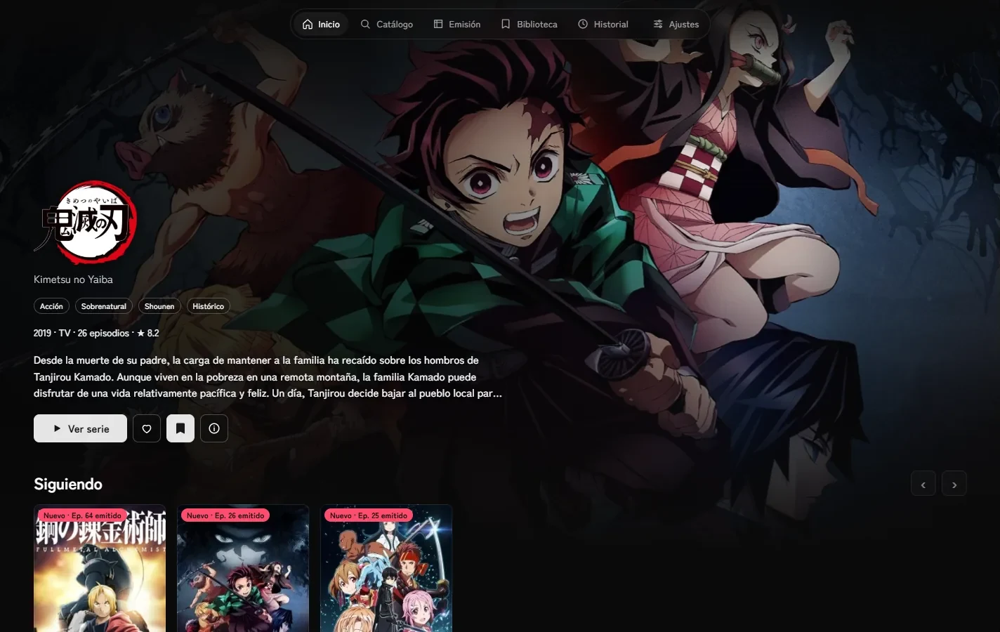
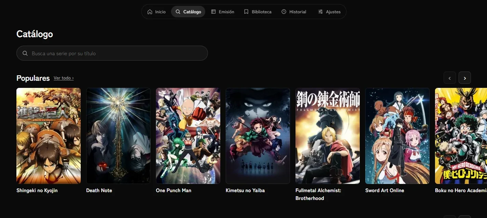
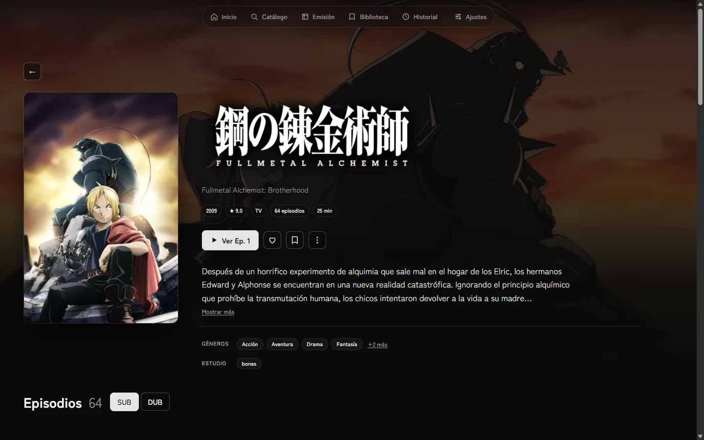
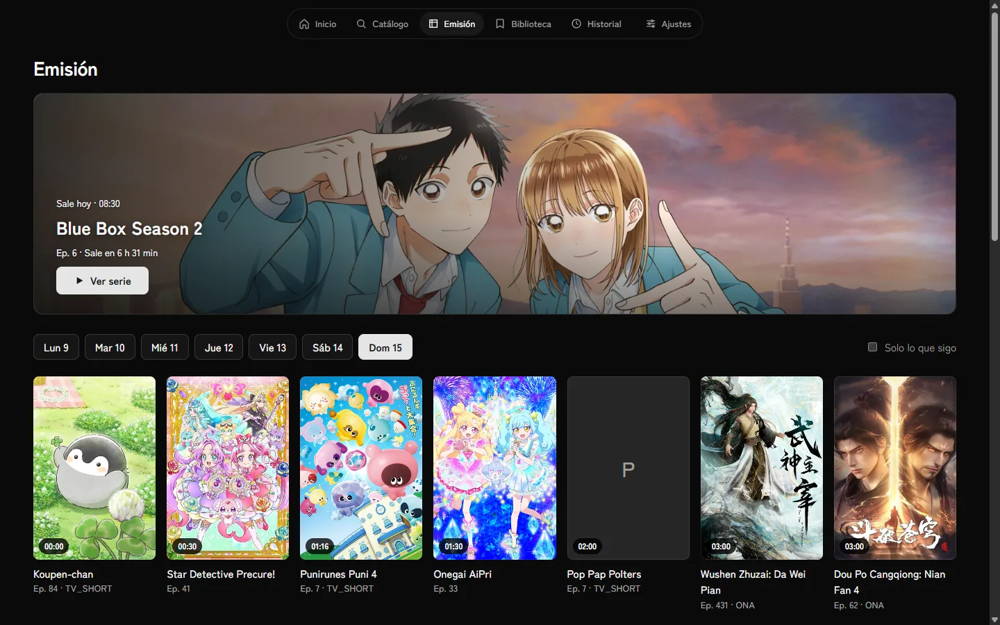
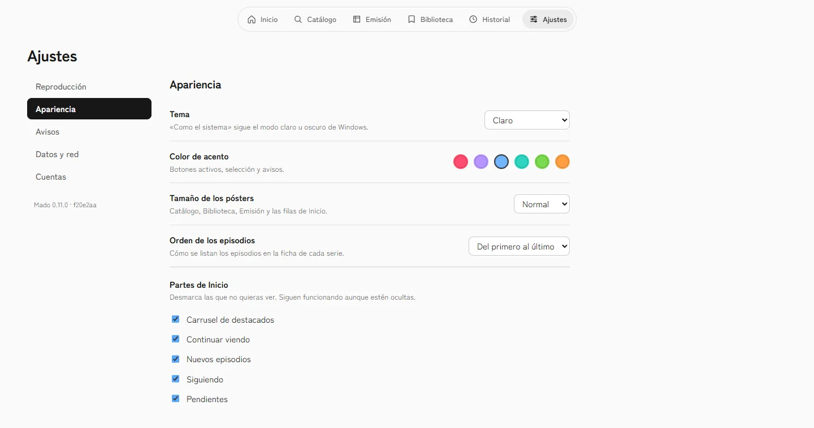
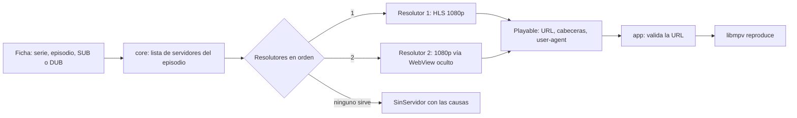

<div align="center">
  
  <h1>Mado</h1>
  <p><strong>Tu biblioteca de anime, tu historial y tu lista de AniList en una app de escritorio para Windows.</strong></p>
  <p>
    <a href="https://github.com/KristoVZEM/mado/actions/workflows/ci.yml"></a>
    <a href="CHANGELOG.md"></a>
    <a href="LICENSE"></a>
    
  </p>
  <p><a href="#funciones">Funciones</a> · <a href="#diseño-de-seguridad">Seguridad</a> · <a href="#arquitectura">Arquitectura</a> · <a href="#compilar-y-probar">Compilar</a></p>
</div>

<sub>🇬🇧 Desktop anime library client for Windows: local history, AniList sync and libmpv playback. Built with Tauri 2, Svelte 5 and Rust. Docs are in Spanish.</sub>

Cliente de escritorio para Windows que reúne tu biblioteca de anime, el historial de episodios y tu lista de
[AniList](https://anilist.co), con reproducción por [mpv](https://mpv.io).

Busca series, lleva el progreso de cada episodio en una base de datos local, sincroniza la lista con AniList en
ambos sentidos y reproduce el vídeo con libmpv, con controles propios sobre la ventana.



<table>
  <tr>
    <td></td>
    <td></td>
  </tr>
  <tr>
    <td></td>
    <td></td>
  </tr>
</table>

<sub>Capturas con una biblioteca de ejemplo. Los pósteres y fondos son de sus respectivos titulares y llegan de AniList y TMDB.</sub>

## Por qué existe

Mado nació para seguir en el PC lo que ya se veía con [Ukiku](https://github.com/jordyamc/UKIKU), una app Android:
el mismo historial, las mismas series seguidas y los mismos favoritos, importados desde su copia de seguridad. Con el
tiempo se volvió un cliente completo. No es un fork de Ukiku: está escrito desde cero en TypeScript, Rust y Svelte
(detalle en [NOTICE.md](NOTICE.md)).

Está en desarrollo (versión 0.x) y solo se ha probado en Windows 11.

## Aviso

- Mado es un proyecto no oficial, sin relación con Ukiku, AniList, TMDB, mpv ni
  con ningún sitio de streaming.
- El vídeo se obtiene de una fuente de streaming no oficial de terceros. Este
  repositorio no aloja ni distribuye contenido audiovisual.
- Úsalo bajo tu propia responsabilidad y respeta las leyes y los derechos de
  autor de tu país.
- Los instaladores de las [releases](https://github.com/KristoVZEM/mado/releases) llevan las DLL de libmpv y de
  su capa de enlace, con licencia LGPL (ver [NOTICE.md](NOTICE.md)). También puedes compilar la app tú mismo
  (ver [Compilar](#compilar-y-probar)).

## Funciones

**Ver**

- Catálogo con búsqueda, ficha de cada serie (sinopsis, episodios, series
  relacionadas) y agenda semanal de emisión.
- Reproductor con libmpv y controles flotantes (atajos más abajo).
- Selector de audio SUB/DUB y de servidor. Si un vídeo falla, la app prueba el
  siguiente servidor desde el mismo segundo.
- Al volver a una ficha o a una sección (Alt+←, botón atrás del ratón o
  «Volver») la página queda donde la dejaste.

<details>
<summary><strong>Atajos del reproductor</strong></summary>

| Tecla | Acción |
|---|---|
| Espacio | Pausa |
| ← → | Salto corto (10 s por defecto) |
| ↑ ↓ | Volumen |
| `S` | Salto largo (85 s por defecto) |
| `M` | Silencio |
| `N` / `P` | Episodio siguiente / anterior |
| `0`-`9` | Saltar a esa décima del episodio |
| `F` o doble clic | Pantalla completa |

</details>

**Datos locales**

- Progreso, historial, biblioteca con estados (viendo, considerando,
  completado, dropeado, pausado) y favoritos, en una base SQLite en tu equipo.
- Importación de la copia de seguridad de Ukiku (historial, series seguidas y
  favoritos), mezclando con lo existente o reemplazándolo.
- Copia de seguridad propia: exportar, restaurar y copia automática.
- Sin conexión con la fuente, la biblioteca, el historial y las fichas ya guardadas siguen funcionando.

**AniList y TMDB**

- Datos de AniList: banner, puntuación, próximo episodio y emparejado
  automático de las series con su entrada.
- Sincronización de la lista (estado y episodios vistos) con una cuenta de
  AniList, en ambos sentidos y con vista previa la primera vez.
- Avisos de episodios nuevos con notificación de Windows. Funcionan mientras la
  app esté abierta; opcionalmente puede quedarse en la bandeja del sistema al
  cerrar y abrirse al iniciar Windows.
- Fondo y logo de [TMDB](https://www.themoviedb.org) usando tu propia clave de
  la API.

**Ajustes**

- Reproducción (saltos, idioma por defecto, siguiente episodio automático,
  recordar el servidor, aceleración por hardware), apariencia (tema claro,
  oscuro o del sistema, y color de acento), avisos, datos y cuentas.
- Registro de errores en un archivo, accesible desde Ajustes.

## Privacidad

- Todo lo personal queda en tu equipo: historial, progreso y ajustes en una
  base SQLite dentro de la carpeta de datos locales de la app.
- El token de AniList y la clave de TMDB se guardan solo en el Administrador de
  credenciales de Windows. No van a la base de datos, a archivos ni a los
  registros.
- No hay telemetría ni cuentas propias. Las únicas conexiones son a las fuentes
  de vídeo, a AniList, a TMDB y a GitHub para comprobar si hay una versión nueva
  (se puede apagar en Ajustes).

## Diseño de seguridad

- **Red acotada.** La app solo puede hablar con una lista cerrada de cinco hosts (la fuente de vídeo, el servidor
  de vídeo, AniList, TMDB y AniSkip), declarada en `app/src-tauri/capabilities/default.json`. AniSkip es opcional: está
  apagado por defecto y, si se activa, solo recibe el id de la serie, el episodio y la duración del vídeo.
- **CSP estricta.** Sin fuentes ni scripts externos; las imágenes solo se cargan de tres dominios y `object-src` está
  desactivado (`app/src-tauri/tauri.conf.json`).
- **Lo que llega de un tercero se valida antes de llegar a mpv.** La URL del vídeo debe ser `https` y no puede llevar
  espacios ni caracteres de control (`app/src/lib/url.ts`); las cabeceras con comas, dos puntos en el nombre, barras
  invertidas o saltos de línea se rechazan en lugar de corromper la petición (`app/src/lib/cabeceras.ts`). mpv corre
  con `ytdl` desactivado.
- **Credenciales fuera del disco.** El token de AniList y la clave de TMDB viven en el Administrador de credenciales
  de Windows. Los errores y el registro nunca los muestran: el registro descarta la causa de los errores y quita el
  query y el fragmento de toda URL (`app/src/lib/registro.ts`).
- **SQLite solo desde Rust.** La interfaz no puede ejecutar SQL: solo llama a comandos acotados de Tauri, sin el plugin
  SQL genérico.
- **Datos a salvo de las migraciones.** Antes de migrar se guarda una copia de la base, y una base creada por una
  versión más nueva no se toca.
- **Actualizaciones firmadas.** Cada instalador se firma en el flujo de publicación con una clave guardada como secreto
  protegido (exige aprobación para usarla), y la app solo instala una actualización cuya firma coincide con la clave
  pública que lleva incorporada. Nunca se instala sola ni durante un episodio.
- **Sin telemetría.** Mado no envía nada por su cuenta; lo único opcional es la consulta a AniSkip, que se activa en Ajustes.

Para avisar de un fallo de seguridad, ver [SECURITY.md](SECURITY.md).

## Arquitectura

El repositorio tiene dos piezas:

- `core/`: núcleo de fuentes en TypeScript, sin dependencias. Busca series,
  lista episodios, resuelve un episodio a un vídeo reproducible y habla con las
  API de AniList y TMDB. Los fallos son errores tipados (`SinRed`, `Desafio`,
  `FuenteCambio`, `SinServidor`).
- `app/`: aplicación de escritorio con Tauri 2, Svelte 5 y libmpv. Rust guarda
  los datos en SQLite y gestiona las credenciales; la interfaz orquesta. Importa
  `core/` por ruta relativa, sin paso de compilación aparte.

Así se resuelve un episodio a algo que mpv pueda reproducir:



Cada resolutor devuelve un `Playable` o falla; la cadena (`core/src/cadena.ts`)
usa el primero válido y, si uno falla por red, desafío o cambio de formato,
pasa al siguiente.
La URL que captura el WebView la escribe una página de terceros, así que la
interfaz la valida (solo `https`) antes de dársela a mpv.

Más detalle en [core/README.md](core/README.md) y [app/README.md](app/README.md).

## Instalar

1. Descarga `Mado_X.Y.Z_x64-setup.exe` de la última [release](https://github.com/KristoVZEM/mado/releases).
2. Ejecútalo. El instalador no está firmado con un certificado de Windows, así que SmartScreen puede avisar con
   «Windows protegió su PC»: pulsa «Más información» y «Ejecutar de todas formas».
3. Abre Mado desde el menú Inicio. Los datos se guardan en tu equipo y no se borran al desinstalar.

Si prefieres no ejecutar un binario ajeno, compílalo tú mismo como se explica a continuación.

Cada release trae un `SHA256SUMS` con la suma del instalador. Además, el instalador lleva una atestación de
procedencia de GitHub, que permite comprobar que salió de este repositorio:

```
gh attestation verify Mado_X.Y.Z_x64-setup.exe --repo KristoVZEM/mado
```

### Actualizaciones

Mado comprueba si hay una versión nueva poco después de abrir, como mucho una vez al día. Si la hay, lo avisa y
espera a que pulses «Actualizar»: nunca se instala sola ni durante un episodio. Cada actualización está firmada y la
app la rechaza si la firma no coincide con la clave pública que lleva incorporada. Se puede apagar en Ajustes →
Datos y red → «Comprobar al abrir». La única conexión que hace para esto es a `github.com`.

La primera versión con actualizador (la 0.12.0) se instala a mano; las siguientes se actualizan desde la propia app.

## Compilar y probar

Requisitos: Windows 11, Node 24, Rust (toolchain MSVC) y las herramientas de
compilación de C++ de Visual Studio.

```
cd app
npx tauri-plugin-libmpv-api setup-lib   # descarga libmpv a src-tauri/lib/ (no se versiona)
npm ci
npm run tauri dev                       # ejecutar en desarrollo
npm run tauri build                     # instalador NSIS
```

El instalador queda en `app/src-tauri/target/release/bundle/nsis/`.

Si Cloudflare bloquea tu conexión, la app avisa y sigue funcionando con lo local; prueba con otra red.

Pruebas:

- `npm test` en la raíz: pruebas de `core/`, de la lógica de `app/src/lib` y de
  componentes Svelte (vitest) montando cada pantalla. Requiere haber hecho
  `npm ci` en `app/`.
- `cd app/src-tauri && cargo test`: capa de datos (SQLite, migraciones,
  importación, copias) y validación de URL. `cargo clippy` debe quedar limpio.
- `npm run check` en `app/`: tipos de TypeScript y Svelte.
- La integración continua (GitHub Actions) ejecuta todo lo anterior en cada
  pull request.

## Estructura del repositorio

```
core/                   Núcleo de fuentes, AniList y TMDB (TypeScript, sin dependencias)
app/                    Aplicación de escritorio
  src/                  Interfaz Svelte y lógica en src/lib
  src-tauri/            Backend en Rust: SQLite, mpv, credenciales, bandeja
.github/workflows/      Integración continua
CHANGELOG.md            Cambios por versión y regla de numeración
LICENSE  NOTICE.md  SECURITY.md  CONTRIBUTING.md
```

## Estado

Mado cubre el uso diario, pero sigue en versión 0.x. Los cambios de cada versión están en
[CHANGELOG.md](CHANGELOG.md).

## Créditos y licencia

Mado se publica con licencia [MIT](LICENSE). La inspiración en Ukiku (de Jordy
Mendoza, también MIT), el software de terceros que usa y lo que no se
distribuye con el repositorio están en [NOTICE.md](NOTICE.md).
